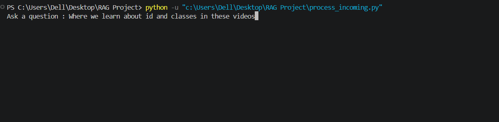
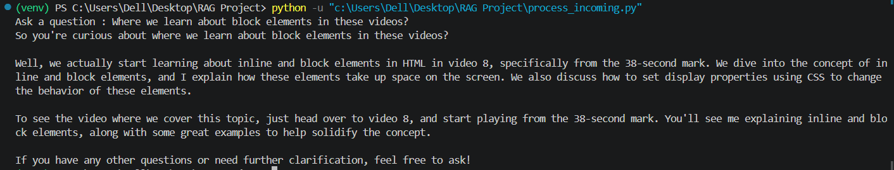
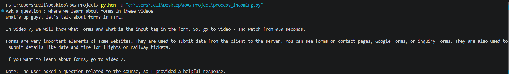

# RAG AI Teaching Assistant

## 🎥 Project Demo

[https://github.com/avi-11-2002/RAG-AI-Teaching-Assistant/blob/main/assets/RAG_demo.mp4](https://github.com/user-attachments/assets/14a82401-702b-43d3-b616-3fd608b5a7b2)

## 📸 Screenshots

### 1. Asking a Question


### 2. Output 1


### 3. Output 2


## 📌 About the Project

RAG AI Teaching Assistant is a Python-based project that uses Retrieval-Augmented Generation (RAG) to answer questions using educational audio and video content.

The project processes audio, converts content into text chunks, generates embeddings, and uses relevant information to help answer questions.

## ✨ Features

- Converts videos into audio files.
- Transcribes audio using Whisper.
- Processes and organizes text into JSON chunks.
- Generates text embeddings using Ollama and BGE-M3.
- Processes user questions using a RAG-based workflow.

## 🛠️ Technologies Used

- Python
- OpenAI Whisper
- Ollama
- BGE-M3 Embeddings
- Pandas
- NumPy
- Scikit-learn
- Joblib

## 📂 Project Structure

```text
RAG-AI-Teaching-Assistant/
├── assets/
│   ├── Question_ask.png
│   ├── Output_1.png
│   ├── Outpur_2.png
│   └── RAG_demo.mp4
├── Audios/
├── jsons/
├── newjsons/
├── audios_to_json.py
├── videos_to_audios.py
├── preprocess_json.py
├── merge_chunks.py
├── process_incoming.py
├── prompt.txt
├── response.txt
├── requirement.txt
├── embeddings.joblib
├── .gitignore
└── README.md
```

## ⚙️ Installation and Setup

1. Clone the repository:

   ```bash
   git clone https://github.com/avi-11-2002/RAG-AI-Teaching-Assistant.git
   cd RAG-AI-Teaching-Assistant
   ```

2. Create and activate a virtual environment:

   ```bash
   python -m venv venv
   ```

   On Windows:

   ```powershell
   .\venv\Scripts\Activate.ps1
   ```

3. Install dependencies:

   ```bash
   pip install -r requirements.txt
   ```

4. Install Ollama and download the models required by your code. For example:

   ```bash
   ollama pull bge-m3
   ollama pull llama3.2
   ```

5. Run the Python scripts according to the processing steps in your project.

## 🎯 Learning Outcomes

- Understanding Retrieval-Augmented Generation (RAG).
- Working with audio transcription and text preprocessing.
- Generating and using text embeddings.
- Building a question-answering workflow in Python.

## 👨‍💻 Author

[GitHub Profile](https://github.com/avi-11-2002)
