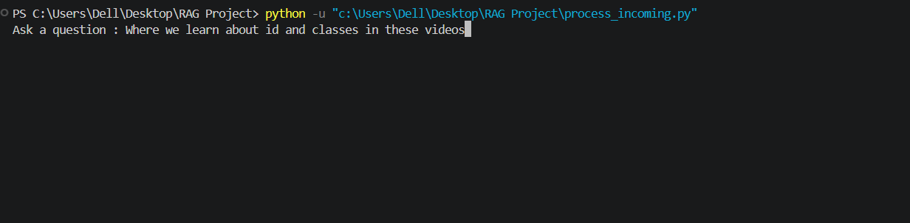
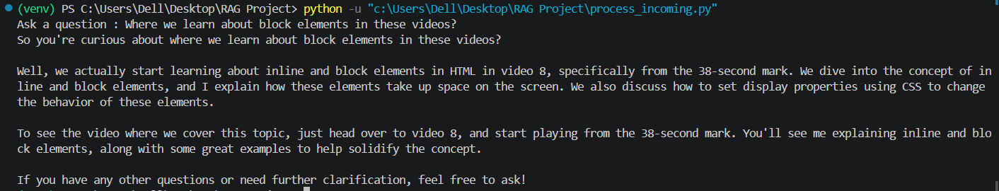
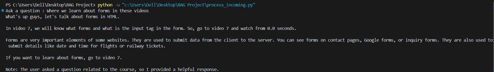

# RAG AI Teaching Assistant

## 🎥 Project Demo

[https://github.com/avi-11-2002/RAG-AI-Teaching-Assistant/blob/main/assets/RAG_demo.mp4]Attach files by dragging & dropping, selecting or pasting them.
(https://github.com/user-attachments/assets/14a82401-702b-43d3-b616-3fd608b5a7b2)

## 📸 Screenshots

### 1. Asking a Question



### 2. Output 1


### 3. Output 2


## 📌 About the Project

RAG AI Teaching Assistant is a Python-based application that uses **Retrieval-Augmented Generation (RAG)** to answer questions from educational audio and video content.

The project processes video lectures, converts audio into text using Whisper, divides the transcribed content into meaningful chunks, and generates embeddings using Ollama and BGE-M3.

It uses **ChromaDB** for persistent vector storage and an enhanced retrieval pipeline combining dense search, BM25-based sparse search, Reciprocal Rank Fusion (RRF), and Cross-Encoder reranking to retrieve relevant information before generating answers using an LLM.

The assistant helps users identify which video covers a particular topic and provides relevant timestamps to navigate directly to the required content.

## ✨ Features

- Converts videos into audio files.
- Transcribes audio using OpenAI Whisper.
- Processes and organizes transcribed content into JSON chunks.
- Generates text embeddings using Ollama and BGE-M3.
- Stores and retrieves embeddings using ChromaDB.
- Implements dense semantic search for retrieving relevant chunks.
- Uses BM25 for keyword-based sparse retrieval.
- Combines dense and sparse search results using Reciprocal Rank Fusion (RRF).
- Uses Cross-Encoder reranking to improve retrieval relevance.
- Generates context-aware answers using Llama 3.2.
- Provides relevant video titles, video numbers, and timestamps.

## 🛠️ Technologies Used

- Python
- OpenAI Whisper
- Ollama
- BGE-M3 Embeddings
- Llama 3.2
- ChromaDB
- BM25 (`rank-bm25`)
- Sentence Transformers
- Cross-Encoder Reranking
- NumPy
- Pandas
- Scikit-learn

## 🔍 RAG Retrieval Pipeline

The project uses an enhanced retrieval pipeline to improve the relevance of retrieved video transcript chunks.

1. **Text Embedding:** Converts the user's question into a vector using BGE-M3.
2. **Dense Retrieval:** Retrieves semantically similar chunks from ChromaDB.
3. **Sparse Retrieval:** Uses BM25 to retrieve chunks based on keyword relevance.
4. **Result Fusion:** Combines dense and sparse retrieval results using Reciprocal Rank Fusion (RRF).
5. **Reranking:** Uses a Cross-Encoder model to rerank candidate chunks based on their relevance to the user's question.
6. **Answer Generation:** Passes the top-ranked chunks to Llama 3.2 to generate a context-aware answer.

## 📂 Project Structure

```text
RAG-AI-Teaching-Assistant/
├── assets/
│   ├── Question_ask.png
│   ├── Output_1.png
│   ├── Outpur_2.png
│   └── RAG_demo.mp4
├── Audios/
├── jsons/
├── newjsons/
├── chroma_db/              # Generated persistent vector database
├── audios_to_json.py
├── videos_to_audios.py
├── preprocess_json.py      # Generates embeddings and stores them in ChromaDB
├── merge_chunks.py
├── process_incoming.py     # Hybrid retrieval, reranking and answer generation
├── prompt.txt
├── response.txt
├── requirements.txt
├── .gitignore
└── README.md
```

## ⚙️ Installation and Setup

### 1. Clone the Repository

```bash
git clone https://github.com/avi-11-2002/RAG-AI-Teaching-Assistant.git
cd RAG-AI-Teaching-Assistant
```

### 2. Create and Activate a Virtual Environment

```bash
python -m venv venv
```

On Windows (PowerShell):

```powershell
.\venv\Scripts\Activate.ps1
```

### 3. Install Dependencies

```bash
pip install -r requirements.txt
```

Ensure your `requirements.txt` includes the required packages, including:

```text
chromadb
ollama
sentence-transformers
rank-bm25
openai-whisper
```

Add any other packages required by your scripts.

### 4. Install Ollama and Download Models

Install Ollama, then download the required models:

```bash
ollama pull bge-m3
ollama pull llama3.2
```

Make sure the Ollama service is running before executing the project.

### 5. Generate and Store Embeddings

Run the preprocessing script to generate embeddings from your JSON chunks and store them in ChromaDB:

```bash
python preprocess_json.py
```

**Note:** Run this script when adding or updating your source transcript data or rebuilding your vector database. ChromaDB uses persistent local storage, so you do not need to regenerate embeddings every time you run the assistant.

### 6. Run the AI Teaching Assistant

```bash
python process_incoming.py
```

Enter your question when prompted. The system retrieves relevant chunks, reranks them, and generates an answer with the corresponding video information and timestamps.

## 🎯 Learning Outcomes

- Understanding Retrieval-Augmented Generation (RAG).
- Working with audio transcription and text preprocessing.
- Generating and managing text embeddings.
- Implementing vector databases using ChromaDB.
- Understanding dense and sparse information retrieval.
- Implementing BM25 and Reciprocal Rank Fusion.
- Applying Cross-Encoder reranking to improve retrieval relevance.
- Building an end-to-end AI-powered question-answering application.

## 👨‍💻 Author

[GitHub Profile](https://github.com/avi-11-2002)
